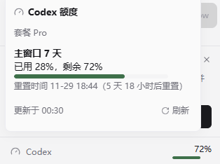

# aio-quota

Paseo 插件：在侧边栏显示 AIO Coding Hub 的 Codex 额度。

## 截图



## 侧边栏

- footer 只有一个 Codex 条目：单行显示名称、剩余百分比和细条，保持紧凑
- 剩余百分比取所有可用窗口里最低的一个，避免漏掉更紧的窗口
- popover 显示套餐、各窗口的已用和剩余百分比、窗口长度、重置时间（本地时间和倒计时）、更新时间，以及手动刷新按钮
- 剩余不足阈值时使用警告色或危险色；AIO 报告额度已达上限时按危险色处理
- 定期自动刷新；点击条目或 popover 里的刷新按钮会绕过服务端缓存
- 请求失败时 footer 显示「额度不可用」，错误详情在 popover；接口没有额度窗口时显示「无可用额度窗口」

## 安装

要求 Paseo 0.17.1 或更高版本。从 GitHub 的 monorepo 子目录安装：

```bash
paseo plugin install github:plusls/paseo-plugins:plugins/aio-quota
```

本地开发时在仓库根目录执行：

```bash
paseo plugin install "$PWD/plugins/aio-quota"
```

同一 daemon 已安装同 ID 插件时先执行 `paseo plugin remove aio-quota`。移除目录插件只删除配置，不删除源码目录。

daemon 所在机器需要能访问 AIO Coding Hub 的 usage 接口，默认地址是 `http://127.0.0.1:37123/v1/usage`。插件没有运行时依赖，Paseo 直接编译 TypeScript，不需要额外的构建步骤。

## 配置

在 Paseo 的 Settings → Plugins → aio-quota 里打开设置，可以修改 `Usage 接口地址`。默认值为 `http://127.0.0.1:37123/v1/usage`，只接受 http 和 https 地址。保存后侧边栏会立即刷新。

设置按 host 保存，由 daemon 发起请求，因此填写的是 daemon 能访问的地址，不是客户端本机地址。

## 数据来源

插件在 daemon 上请求配置的 usage 地址，默认是 `GET http://127.0.0.1:37123/v1/usage`，只读取以下额度字段：

- `plan_type`
- `rate_limit.limit_reached`
- `rate_limit.primary_window` 和 `rate_limit.secondary_window` 中的 `used_percent`、`limit_window_seconds`、`reset_after_seconds`、`reset_at`

窗口长度按 `limit_window_seconds` 换算后展示，不使用 AIO 数据库里的窗口名称。默认地址和设置 schema 的入口在 `shared/settings.ts`；服务端缓存和请求超时的常量入口在 `server/quota.ts`；自动刷新间隔的入口在 `client/quota.tsx`。

## 隐私边界

- 响应里的 `email`、`account_id`、`user_id` 和其他账号标识在解析时丢弃，不显示、不写日志、不放进缓存快照
- `plan_type` 只映射为本地套餐标签；无法识别的值显示「未知套餐」，原始字符串不进入快照
- 快照由插件重新构造，只包含套餐和额度窗口字段，不保留原始 JSON
- 错误消息只包含 HTTP 状态码和字段路径，不拼接响应体
- 配置的接口地址作为 host 级插件设置保存在 Paseo 侧

## 限制

- 默认使用 daemon 本机地址；AIO Coding Hub 在另一台机器时，把地址改成 daemon 能访问的 URL
- 接口地址只支持 http 和 https
- 只处理 Codex 额度，不读取 AIO 的 SQLite，不显示其他来源的余额，不扩展到其他 provider
- 不注册原生 usage source，额度只出现在插件自己的侧边栏条目和 popover 中
- `rate_limit` 为 null 或两个窗口都为 null 时显示「无可用额度窗口」，不伪造百分比

## 开发

在仓库根目录执行：

```bash
pnpm install
pnpm --filter aio-quota run lint
pnpm --filter aio-quota run typecheck
pnpm --filter aio-quota pack --pack-destination "$PWD/dist"
```

打包产物是 `dist/aio-quota-<version>.tgz`，版本取自 `package.json`。`package.json` 保持 `private: true`，不发布到 npm。

GitHub Actions 跑 lint、typecheck 和 pack，打包产物作为 workflow artifact 上传；工作流定义在仓库根目录的 `.github/workflows/ci.yml`。
