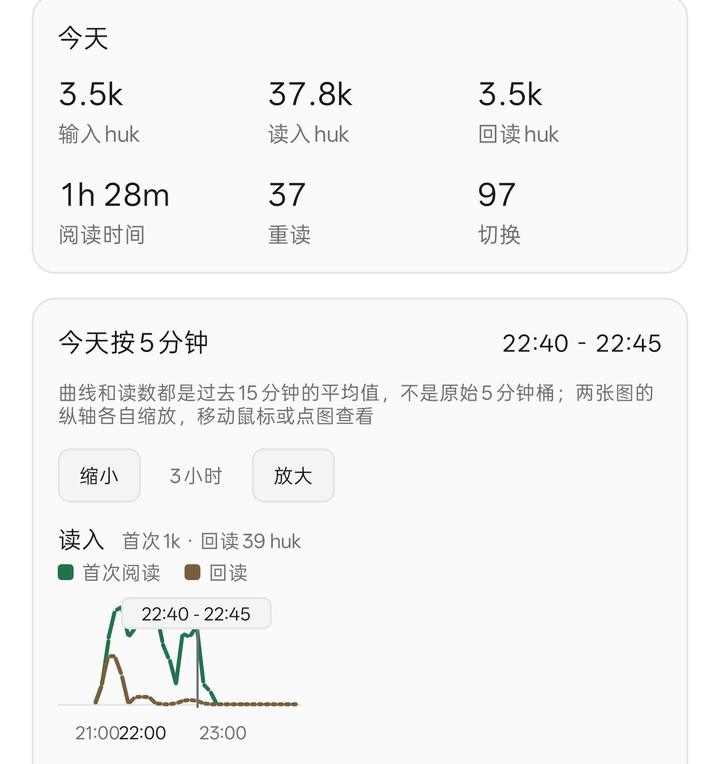

# huken

Paseo 插件：huken（human token），统计人类实际读到的 AI 内容、自己输入的字数、回读和上下文切换。

显示名是 huken，安装命令和插件 ID 仍是 `human-tokens`。

## 截图



## 做什么

- 侧边栏底部用 ↓ / ↑ 显示累计读入和输入，以及 cache miss 比例；读速在明细页
- 点击打开明细：人类输入、AI 产出、实际读入、读速、回读速度、输出速度、回读占比、重读次数、切换 agent、消息数
- 今天按 5 分钟：读入和输入两张折线图；曲线和鼠标读数都取过去 15 分钟的平均值，图面按 5 分钟绘制，默认显示最后一个活动时间附近 3 小时，滚轮或缩小/放大按钮在 1-24 小时之间缩放，移动鼠标、点图或键盘聚焦后按左右方向键查看该点的平滑值
- 今天卡片显示输入、读入、回读、阅读时间、重读和切换
- 7 天 / 30 天切换；每日首次阅读和回读的堆叠柱状图，以及单独的每日输入 huken 柱状图

阅读估算只看已完成的 AI 回复在屏幕上停留了多久。快速滚过不会算读完，长消息按实际看到的部分累计；离开一会儿再回来看，会单独累计回读的内容和次数。插件不判断你是否真的在看，也不补算历史。

huk 是 huken 的缩写，1 huk = 1 个字符，所有数字适合比较趋势，不是模型的计费 token。

5 分钟数据从这个版本开始记录，之前的历史没有这个粒度；打开旧数据时曲线只显示新版本之后的部分。阅读、回读、输入和活跃时间按批次构建时的本地 5 分钟桶归属；上传失败或长时间离线后，恢复时新建的批次按恢复后的桶归属，积压的增量可能集中记到少数几个桶。5 分钟桶保留 90 天，更早的数据仍以日汇总保留。

指标定义、采集模型、平台适配、合并规则和已知限制见 [OVERVIEW.md](OVERVIEW.md)。

## 安装

要求 Paseo 0.17.1 或更高版本。从 GitHub 的 monorepo 子目录安装：

```bash
paseo plugin install github:plusls/paseo-plugins:plugins/human-tokens
```

本地开发时在仓库根目录执行：

```bash
paseo plugin install "$PWD/plugins/human-tokens"
```

同一 daemon 已安装同 ID 插件时先执行 `paseo plugin remove human-tokens`。移除目录插件只删除配置，不删除源码目录。

## 数据

- 统计在设备上完成，结果保存在 Paseo 的插件数据里
- 数据默认保存在 `PASEO_HOME/plugin-data/human-tokens/`，`PASEO_HOME` 未设置时用 `~/.paseo`
- 消息正文只在设备上参与统计，不上传、不保存、不写日志
- 输入框内容只比较长度，不保存文本
- 不读 agent 的会话记录或模型 token 用量

## 开发

在仓库根目录执行：

```bash
pnpm install
pnpm run lint
pnpm run typecheck
pnpm --filter human-tokens pack --pack-destination "$PWD/dist"
```

本地安装后改动执行：

```bash
paseo plugin reload human-tokens
```

查看插件侧输出：

```bash
paseo plugin logs human-tokens
```

web 端依赖 host 页面的 `data-testid` 和 React fiber props，native 端依赖 Fabric host instance 和组件 props。这些都是内部实现，Paseo 升级后可能失效；选择器或 props 变化时通常只会没有新数据，组件结构变化但坐标仍有效时可能得到错误的可见比例，升级后需要实测校准。

## 限制

- cache hit 不可观测，界面只显示重读造成的 cache miss 比例
- 5 分钟数据从本版本开始记录，之前的历史没有这个粒度
- 5 分钟归属按客户端构建批次的时间；上传失败、离线积压或跨桶的长批次会把增量集中记到少数几个桶
- 5 分钟明细保留 90 天，更早的数据只保留日汇总
- 阅读时长按字数和可见比例估算，不判断你是否真的在看
- 只统计插件运行期间看到过的已完成 AI 回复；不补算历史，也不统计流式消息、工具调用和用户消息
- native 端较短的粘贴可能被当成输入
- 回读速度只用本地回看时间计算，跨会话推断的回读没有对应时长，速度只适合看趋势
- 跨午夜且上传失败或长时间离线时，恢复前的活动可能记到恢复当天
- 页面刷新或 app 重启后本地阅读状态清空，之前读过的内容再次出现时会按回读累计
- 切换 host 时，切换前积累的数据可能被送到新 host
